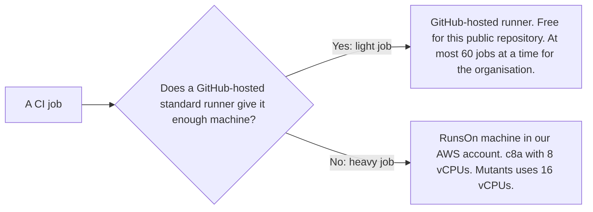

# Move CI from Blacksmith to GitHub-hosted runners and RunsOn

We decided in October 2026 to stop running CI on Blacksmith. Light jobs run on
GitHub-hosted standard runners. Those runners cost nothing for this public
repository.

Heavy jobs run on RunsOn. RunsOn starts a machine in our own AWS account for
each job. Heavy jobs use c8a machines with 8 vCPUs. Mutants uses a
c8a machine with 16 vCPUs. The other repositories that share the CI budget
move their Blacksmith jobs to RunsOn too.

We made the change because of cost. CI for this repository cost about $3,865 a
month on Blacksmith at October 2026's pace. That was 20 times September's
cost. The CI budget for this repository and the others that share it is
$1,000 a month.

## Considered options

- **Stay on Blacksmith and run fewer jobs.** We modelled October's jobs with
  gate checks in place. This repository alone still came to about $2,000 a
  month at Blacksmith's prices.
- **Run every job on RunsOn.** Light jobs would then cost money. GitHub-hosted
  runners run them for nothing.
- **Run every job on GitHub-hosted runners.** In the runner trial in pull
  request #1297, jobs took 2.46 times as long overall. The integration suites
  took up to 4.8 times as long.

## Consequences

- GitHub runs at most 60 jobs at a time for the organisation on the Team plan.
  Light jobs wait for a runner when more than 60 jobs are queued.
- We simulated October's light jobs against that limit, with gate checks in
  place. One job in a hundred waited between 7 and 11 minutes.
- A RunsOn job starts 40 to 50 seconds later than a Blacksmith job did.
- RunsOn uses discounted spot machines. When AWS has no spare c8a machines, a
  job runs at the full price. The full price is more than twice the spot
  price. The `family=c8a+m8a` label lets RunsOn try a second machine type
  first.
- Every job sets `timeout-minutes`. In the trial, one job without a limit ran
  for over 2 hours.
- We maintain the RunsOn resources in AWS. They cost $40 to $60 a month.
- RunsOn's pricing page limits its free licence to non-commercial use. The
  trial licence ends in November 2026. Buying a licence is a separate
  decision.
