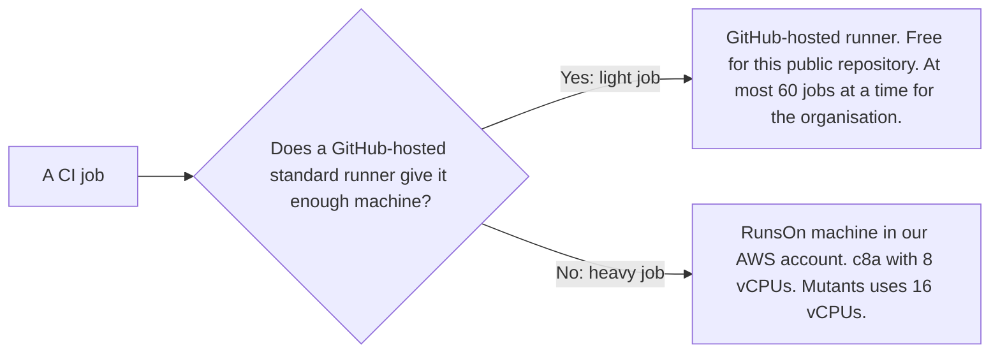

# Move CI from Blacksmith to GitHub-hosted runners and RunsOn

> This architecture decision record (ADR) is no longer in force.
> [ADR 0004](0004-same-size-swap-from-blacksmith-to-runs-on.md) supersedes it.

We decided in October 2026 to stop running CI on Blacksmith.
Light jobs run on GitHub-hosted standard runners.
Those runners cost nothing for this public repository.

Heavy jobs run on RunsOn.
RunsOn starts a machine in our own AWS account for each job.
Heavy jobs use c8a machines with 8 vCPUs.
Mutants, the mutation testing workflow, uses a c8a machine with 16 vCPUs.
The other repositories that share the CI budget move their Blacksmith jobs to RunsOn too.

Heavy jobs stay on x64 machines.
In the runner trial in pull request #1297, arm64 machines were slower than x64 machines, and not cheaper.
Jobs that must run on arm64, such as native arm64 container image builds, are the exception.
Those jobs run on RunsOn's arm64 machines.

We made the change because of cost.
CI for this repository cost about $3,865 a month on Blacksmith at October 2026's pace.
That was 20 times September's cost.
The CI budget for this repository and the others that share it is $1,000 a month.

`.github/CONTEXT.md` defines the terms used here.

## Considered options

We rejected each of these options:

- **Stay on Blacksmith and run fewer jobs.**
  We modelled October's jobs with gate checks in place.
  At Blacksmith's prices, this repository alone still came to about $2,000 a month.
- **Run every job on RunsOn.**
  Light jobs would then cost money.
  GitHub-hosted runners run them for nothing.
- **Run every job on GitHub-hosted runners.**
  In the same trial, jobs took 2.46 times as long overall as on Blacksmith.
  The integration suites took up to 4.8 times as long as on Blacksmith.
- **Build arm64 images on x64 machines.**
  Cross-compiling Rust for another architecture is slow.
- **Run arm64 jobs on GitHub-hosted arm64 runners.**
  Those runners cost money for private repositories.
  So the cost applies to the private repositories that share the CI budget.
  This public repository already builds `linux-arm64-gnu` on a GitHub-hosted arm64 runner for nothing, in `_build-auth-artifacts.yml`.
- **Pull Docker Hub images through a cache in RunsOn's AWS setup.**
  RunsOn documents that cache only for its Terraform or OpenTofu installation.
- **Pull Docker's official images from Amazon Elastic Container Registry (ECR) Public.**
  Every image name in every repository would change.
  Images that are not official would need another source.

## Consequences

- GitHub runs at most 60 jobs at a time for the organisation on the Team plan.
  When more than 60 jobs are queued, light jobs wait for a runner.
- We simulated October's light jobs against that limit, with gate checks in place.
  One job in a hundred waited between 7 and 11 minutes.
- A RunsOn job starts 40 to 50 seconds later than a Blacksmith job did.
- RunsOn uses discounted spot machines.
  When AWS has no spare c8a machines, a job runs at the full price.
  The full price is more than twice the spot price.
  The `family=c8a+m8a` label lets RunsOn try a second machine type before the job runs at the full price.
- Every job sets `timeout-minutes`.
  In the runner trial in pull request #1297, one job without a limit ran for more than 2 hours.
- We maintain the RunsOn resources in AWS.
  Those resources cost $40 to $60 a month.
- Each RunsOn machine has its own public address.
  Docker Hub limits anonymous pulls per address.
  In October 2026, Docker Hub still refused anonymous pulls from RunsOn machines.
  So a job logs in to Docker Hub before it pulls an image.
  Runs for pull requests from forks get no secrets, so they still pull without a login.
- A pull request from a fork would run its code on a machine in our AWS account.
  So this repository requires approval before any outside contributor's workflows run, not only a first-time contributor's.
