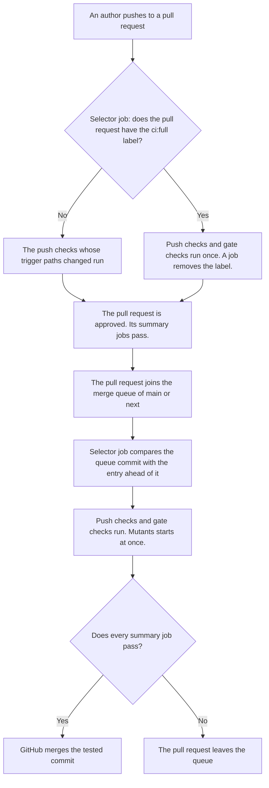

# Merge queues on `main` and `next` run expensive CI checks

> We paused work on this decision in November 2026, until the same-size swap in architecture decision record (ADR) 0004 is in place.
> That swap moves every Blacksmith job in this repository to a RunsOn machine of the same size.
> None of this decision has been built yet.

In October 2026, we decided to split this repository's CI checks into push checks and gate checks.
Push checks run on every push to a pull request.
Gate checks run once, when the pull request is in a merge queue.
The `main` and `next` branches each get a merge queue.

We made the change because of cost.
From 1 to 20 October 2026, 89% of this repository's CI spending came from runs for pull requests.
Each push to a pull request ran the expensive checks again.
This decision runs the expensive checks less often.

ADR 0002 moved jobs to cheaper machines.
ADR 0004 has since superseded ADR 0002.
ADR 0004 moves every Blacksmith job to a cheaper RunsOn machine of the same size.

The glossary in `.github/CONTEXT.md` defines the terms used here.
The diagram shows each step for one pull request, from a push to the merge.

## Gate checks and push checks

The following checks are gate checks:

- the Test EQL (Encrypt Query Language) suites that need a database: the PostgreSQL shards, the e2e property suite, and the test archive build
- Mutants, the mutation testing job
- CRAP (Change Risk Anti-Patterns)
- the fuzz regression replay
- Go on Windows and macOS, and the Go live tests
- the Drizzle, prisma-next, Supabase, and protect-ffi integration suites
- the two Prisma end-to-end (E2E) suites
- udeps and Miri

Every other check is a push check.

## How the merge queues work

In a merge queue, each pull request is an entry.
For each entry, GitHub builds a queue commit.
The queue commit of an entry contains the entry ahead, plus that entry's pull request.

- The merge queue runs the push checks and the gate checks against the queue commit.
  A failure removes the pull request from the queue.
- Pushes to `main` no longer run the tests.
  The queue has already tested the commit that GitHub merges.
- The `next` branch gets the same branch rules as `main`, including the merge queue.
  When we made this decision, `next` had no protection.
  Pushes to `next` ran no workflows.
- Each queue builds at most 3 entries at once.
  A weekly CI cost report is planned.
  Nobody has built the report yet.
  Once the report exists, it will show whether to change that limit.
- The queues merge with merge commits, as `main` did when we made this decision.
  The selector job compares each queue commit with the entry ahead.
  The comparison needs merge commits or squash merges.

## How a workflow decides what runs

- Every workflow starts with a selector job.
  The selector job runs on a GitHub-hosted runner.
  The selector job selects a check when the change touches one of the check's trigger paths.
  A check's trigger paths are the paths that make the check run when they change.
- In a merge queue, the selector job compares the queue commit with its parent.
  The parent is the entry ahead, so the difference is this pull request alone.
  The entries ahead run their own checks.
  If one of them fails, GitHub rebuilds the entries behind it.
- When the selector job cannot decide, it fails.
  The change then cannot merge until someone runs the selector job again.
  So people notice a fault in the selector job at once.
- Every workflow ends with a summary job.
  The summary job is the only job of the workflow that branch rules require.
- The failsafe is a test in `scripts/__tests__/`.
  The command `pnpm run test:scripts` runs it.
  The failsafe fails when the selector job does not decide whether a job runs.
  A job is exempt only with a written reason.
  The failsafe also fails on an exemption that matches no job.

## Early runs

An author can ask for an early run by adding the `ci:full` label to the pull request.
An early run runs the gate checks on the pull request, before it joins the merge queue.
A job removes the label when the early run starts.
So each early run is a deliberate request.
The merge queue still runs the gate checks again.

GitHub cannot start a workflow only when one particular label is added.
So every workflow starts when any label is added.
A run that starts this way is a label run.
On every label run, the selector job selects the push checks again.
For the `ci:full` label, the selector job selects the gate checks too.

For each check name, GitHub counts the newest result.
So a label run gives new results for the push checks.
A label run cannot hide an earlier push check failure.

A later push or label run without `ci:full` skips the gate checks.
If the summary job of that later run passes, its result replaces the failed result of an early run.

## How Mutants runs

- Mutants is a required gate check.
  Mutants only tests the lines that the pull request changes.
  In a merge queue, Mutants finds those lines the same way as the selector job.
- Mutants runs in every queue entry except the merge of `next` into `main`.
  Each change on `next` has already passed Mutants in the `next` queue.
- Mutants runs as 4 parallel shards on c8a machines with 16 vCPUs.
- In the queue and on early runs, Mutants starts at the same time as the push checks.
  A watcher job cancels Mutants when a push check fails.
- On an early run, a cancelled Mutants run counts as a failure.
  The pull request cannot join the queue until Mutants runs again, or until a later push or label run replaces the result.
- The other heavy gate checks also start at once, as Mutants does.

## Considered options

We rejected each of these options:

- **Run gate checks when a draft pull request becomes ready for review.**
  Agents push to pull requests that are already ready for review.
  So most pushes would still run every check.
- **Run gate checks when a pull request is approved.**
  On `main`, an approval stays valid after later pushes.
  So code pushed after an approval would merge without gate checks.
- **Run gate checks only when an author adds a label, with no merge queue.**
  The gate checks would then depend on people remembering to add the label.
- **Filter workflows by path in `on:`, not in a selector job.**
  GitHub cannot filter `merge_group` events by path.
  If a path filter skips a workflow, the workflow's required checks stay pending.
  GitHub's documentation on required status checks says that a pending required check blocks the merge.
- **Compare each queue commit with the base branch.**
  With 3 entries building, the difference for the third entry would include the two entries ahead of it.
  Mutants would then test the lines of those two entries again.
  A failure could point to another author's lines.
- **Run every check when the selector job cannot decide.**
  No needed check would be skipped.
  But nobody would notice a fault in the selector job.
  Each fault would also cost a full run.
- **Run Mutants on the merge of `next` into `main` as well.**
  Such a run tests every line that `next` added, for a second time.
  In October 2026, such a run reached its 120-minute timeout at least twice on pull request #1229.
- **Run Mutants only in the `main` queue.**
  Mutants would test all of `next` together, when `next` merges into `main`.
  A failure would then point to anyone who changed `next`.
- **Start Mutants after every push check passes.**
  Waiting would spend nothing on failing commits.
  But waiting would add up to 14 minutes to each queue entry and early run.
  In the queue, push checks rarely fail.
  A pull request joins the queue only after its required checks pass.
- **Keep the `ci:full` label until the author removes it.**
  If an author forgot to remove the label, every later push would run every gate check.
- **Select nothing on a label other than `ci:full`.**
  Every job would be skipped.
  GitHub counts a skipped job as a pass.
  A test on 28 October 2026 showed that the result of such a run then replaces an earlier failure.
- **Give the summary job a different name on label runs, or run early runs in separate workflows.**
  With either option, a failed early run would no longer stop a pull request from joining the queue.

## Consequences

- If authors do not ask for an early run, they learn of a gate check failure in the queue.
- A merge waits for the slowest gate check.
  Each queue's status check timeout must be longer than the slowest gate check takes.
- Every workflow with a required summary job must also run on `merge_group`.
  GitHub's merge queue documentation says the queue only starts workflows that run on `merge_group`.
  Without that trigger, the queue would wait for a check that never reports.
- The queue setting "Only merge non-failing pull requests" stays on.
  Without that setting, a pull request that failed could merge with the one behind it.
- The smallest group the queue merges is 1 pull request.
  So a pull request on its own never waits for others.
- Adding any label to a pull request runs its push checks again.
  In October 2026, 74 labels were added to 53 pull requests.
  Dependabot added most of them as it opened each pull request.
  So those labels cost almost nothing extra.
- A test of a merge queue on 28 October 2026 confirmed three behaviours:
  - Commits made by the merge queue pass the rule that requires signed commits.
  - The parent of a queue commit is the entry ahead of it.
    The value of `merge_group.base_sha` is that parent.
  - GitHub does not cancel a running workflow when its entry leaves the queue.
    The run continues to the end.
- A failed entry stays in the queue until the entry ahead of it finishes.
  Meanwhile, GitHub builds the entry behind it.
  The queue commit of that entry contains the failed entry.
- After a flaky push check on an early run, the author must re-run Mutants as well.
- The watcher job waits for up to about 14 minutes.
  While it waits, it uses one of the organisation's 60 GitHub-hosted job slots.
- This decision only covers this repository.
  The `proxy` repository may make the same change later.
