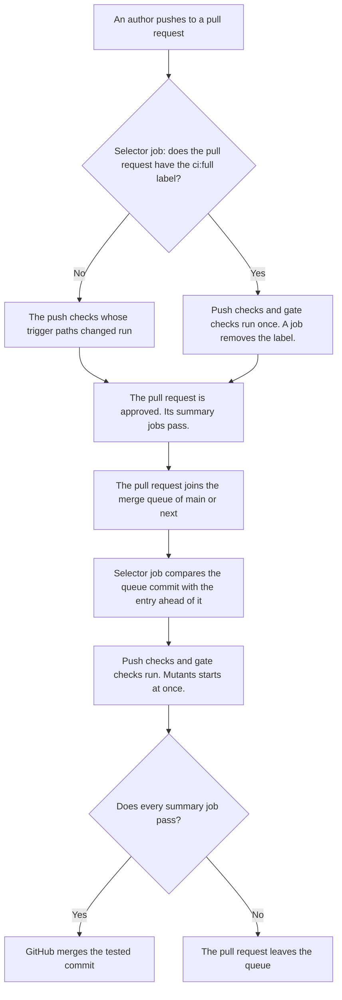

# Run the expensive CI checks in merge queues on `main` and `next`

We decided in October 2026 to split this repository's CI checks into push
checks and gate checks. Push checks run on every push to a pull request. Gate
checks run once, when the pull request is in a merge queue. `main` and `next`
each get a merge queue.

We made the change because of cost. From 1 to 20 October 2026, 89% of this
repository's CI spending came from pull request runs. Each push ran the
expensive checks again. ADR 0002 moves jobs to cheaper machines. This decision
runs the expensive jobs less often.

`.github/CONTEXT.md` defines the terms used here.

## What runs where

These are the gate checks:

- the Test EQL suites that need a database: the PostgreSQL shards, the e2e
  property suite, and the test archive build
- Mutants
- CRAP
- the fuzz regression replay
- Go on Windows and macOS, and the Go live tests
- the Drizzle, prisma-next, Supabase, and protect-ffi integration suites
- the two Prisma E2E suites
- udeps and Miri

Every other check is a push check.

- The merge queue runs the push checks and the gate checks against the queue
  commit. A failure removes the pull request from the queue.
- Pushes to `main` no longer run the tests. The queue has already tested the
  commit that GitHub merges.
- `next` gets the same branch rules as `main`, including the merge queue.
  Until now, `next` had no protection. Pushes to it ran no workflows.
- Each queue builds at most 3 entries at once. The weekly cost report will
  show whether to change this.
- The queues merge with merge commits, as `main` does today. The comparison
  with the entry ahead needs merge commits or squash merges.

## How a workflow decides what runs

- A selector job starts every workflow, on a GitHub-hosted runner. It selects
  the checks whose trigger paths the change touches.
- In a merge queue, the selector job compares the queue commit with its
  parent. The parent is the entry ahead, so the difference is this pull
  request alone. The entries ahead run their own checks. If one fails, GitHub
  rebuilds the entries behind it.
- When the selector job cannot decide, it fails. The change cannot merge until
  someone runs it again. So a fault in the selector job is seen at once.
- A summary job ends every workflow. It is the only job of the workflow that
  branch rules require.
- The failsafe is a test in `scripts/__tests__/`, run by
  `pnpm run test:scripts`. It fails when the selector job does not decide
  whether a job runs. A job is exempt only with a written reason. An exemption
  that matches no job also fails.

## Early runs

An author can add the `ci:full` label to run the gate checks early on the pull
request. A job removes the label when the early run starts. So each early run
is a deliberate request. The queue still runs the gate checks again.

GitHub cannot start a workflow on one label only, so every workflow starts
when any label is added. On every such run, the selector job selects the push
checks again, and the gate checks too for `ci:full`. GitHub counts the newest
result for a check name. So a label run gives fresh results and cannot hide an
earlier failure.

## Mutants

- Mutants is a required gate check. It tests only the lines that the pull
  request changes. In a merge queue, it finds them the same way as the
  selector job.
- It runs in every queue entry except the merge of `next` into `main`. Each
  change on `next` has already passed Mutants in the `next` queue.
- It runs as 4 parallel shards on c8a machines with 16 vCPUs.
- It starts at the same time as the push checks, in the queue and on early
  runs. A watcher job cancels it when a push check fails.
- On an early run, a cancelled Mutants run counts as a failure. The pull
  request cannot join the queue until Mutants runs again.
- The other heavy gate checks also start at once.

## Considered options

- **Run gate checks when a draft pull request becomes ready for review.**
  Agents push to pull requests that are already ready. So most pushes would
  still run everything.
- **Run gate checks when a pull request is approved.** On `main`, an approval
  stays valid after later pushes. So code pushed after an approval would merge
  without gate checks.
- **Run gate checks only when an author adds a label, with no merge queue.**
  That depends on people remembering to add it.
- **Filter workflows by path in `on:`, not in a selector job.** GitHub cannot
  filter `merge_group` events by path. A workflow that a path filter skips
  leaves its required checks pending. GitHub's documentation on required
  status checks says that blocks the merge.
- **Compare each queue commit with the base branch.** With 3 entries
  building, the third entry's difference includes the two ahead of it.
  Mutants would test their lines again. A failure could point to another
  author's lines.
- **Run every check when the selector job cannot decide.** No needed check
  would be skipped. But nobody would notice a fault in the selector job. Each
  fault would also cost a full run.
- **Run Mutants on the merge of `next` into `main` as well.** That run tests
  every line `next` added, a second time. In October 2026, it reached its
  120-minute timeout at least twice on pull request #1229.
- **Run Mutants only in the `main` queue.** All of `next` would be tested at
  once, when it merges into `main`. A failure would then point to anyone who
  changed `next`.
- **Start Mutants after every push check passes.** That spends nothing on
  failing commits. But it adds up to 14 minutes to each queue entry and early
  run. In the queue, push checks rarely fail. A pull request joins only after
  its required checks pass.
- **Keep the `ci:full` label until the author removes it.** A forgotten label
  would run every gate check on every later push.
- **Select nothing on a label other than `ci:full`.** Every job would be
  skipped, and GitHub counts a skipped job as a pass. A test on 28 October
  2026 showed that this run then replaces an earlier failure.
- **Give the summary job a different name on label runs, or run early runs
  in separate workflows.** Either way, a failed early run would no longer stop
  a pull request joining the queue.

## Consequences

- Authors learn of a gate check failure in the queue, unless they ask for an
  early run.
- A merge waits for the slowest gate check. Each queue's status check timeout
  must be longer than that check takes.
- Every workflow with a required summary job must also run on `merge_group`.
  GitHub's merge queue documentation says the queue starts no workflow
  without it. The queue would then wait for a check that never reports.
- The queue setting "Only merge non-failing pull requests" stays on. Without
  it, a pull request that failed could merge with the one behind it.
- The smallest group the queue merges is 1 pull request. So a lone pull
  request never waits for others.
- Every label added to a pull request runs its push checks again. In October
  2026, 74 labels were added to 53 pull requests. Most were Dependabot's,
  added as the pull request opened, so they cost almost nothing extra.
- A test of a merge queue on 28 October 2026 confirmed three behaviours:
  - Commits made by the merge queue pass the rule that requires signed
    commits.
  - A queue commit's parent is the entry ahead of it. `merge_group.base_sha`
    is that parent.
  - GitHub does not cancel a running workflow when its entry leaves the
    queue. The run continues to the end.
- A failed entry stays in the queue until the entry ahead of it finishes.
  Meanwhile, the entry behind it builds on top of the failure.
- After a flaky push check on an early run, the author must re-run Mutants as
  well.
- While it waits, the watcher holds one of the organisation's 60
  GitHub-hosted job slots. It waits up to about 14 minutes.
- This decision covers this repository only. `proxy` may follow later.
