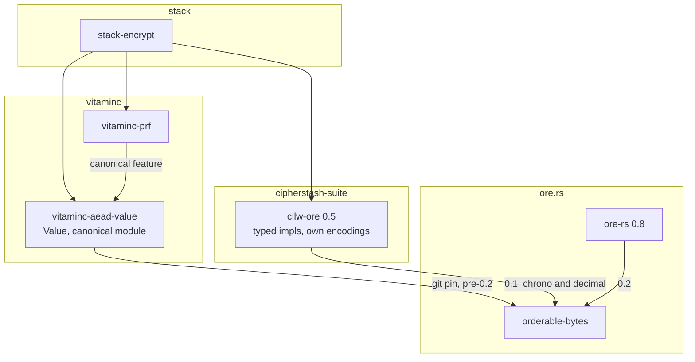
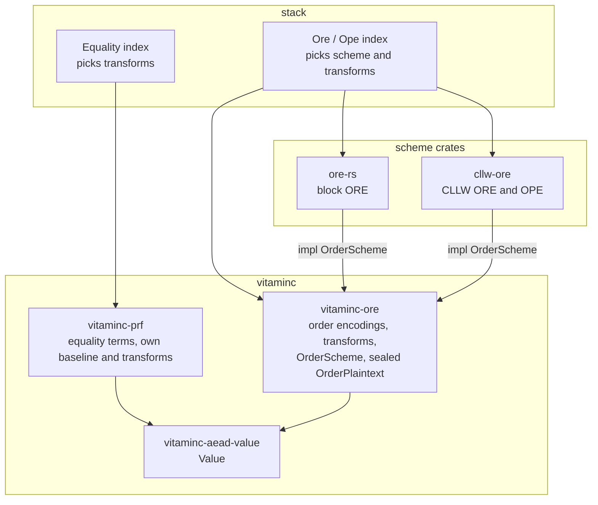

# Order and equality terms: vitaminc at the bottom

> **Plan, not specification.** This document is an indicative sketch of the
> steps required, written before the work was done. It is not kept in step
> with the implementation and must not be used as a formal specification or
> as a reference for reviewing what was actually built: the code, its rustdoc
> and the tests are the source of truth. Where the two disagree, the code wins
> and this document is simply out of date.

**Status:** planned. Decisions settled 2026-10-11, except the one listed
under "Open decision".
**Date:** 2026-10-11
**Amends:** ADR-0002 (`docs/adr/0002-one-value-model-three-encodings-and-eql-v4-by-producer.md`).
The decisions below were folded into the ADR on 2026-10-12, and the ADR is
now the reference for them. This plan keeps the steps.
**Issues:** cipherstash/vitaminc#374 (`vitaminc-ore`), #1063 (index crates)

## Why

Starting on cipherstash/vitaminc#374 under ADR-0002 turned up four problems.

- **Too many dependencies across repositories.** `vitaminc-ore` was to depend
  on cllw-ore and ore-rs and adapt each to its `Scheme` trait, with
  `orderable-bytes` underneath both. Order encodings, scheme traits and term
  derivation ended up spread over three repositories, and every change needed
  releases in all of them.
- **Raw bytes reach the schemes.** cllw-ore and ore-rs accept bytes that the
  caller has already encoded. Bytes encoded by hand (little-endian integers,
  an unflipped sign bit, `f64::to_bits`) encrypt without error and sort
  wrong. Fixing that inside cllw-ore needed wrapper types in `orderable-bytes`
  (cipherstash/ore.rs#103) and a feature split in cllw-ore
  (cipherstash/cipherstash-suite#2308). Cargo features unify across a build,
  so the feature split could not hold whenever anything else in the build
  turned the feature on.
- **PRF depends on ordering.** `vitaminc-prf` reaches `orderable-bytes`
  through `vitaminc-aead-value`'s `canonical` module, which reuses order
  encodings as equality input. Equality needs a canonical form, not an order.
- **One canonical form for both term kinds is too rigid.** ADR-0002 builds
  equality and order terms from the same canonical form. A leakage-tuned
  domain needs them to differ, for example an exact timestamp for equality
  and only the day for order.

## Decisions

### vitaminc is the bottom of the stack

- `vitaminc-ore` owns:
  - the order encodings;
  - an `OrderScheme` trait;
  - the derivation of order terms from `&Value`, generic over the scheme.

  It depends on no scheme crate.
- A scheme's input is a sealed type, `OrderPlaintext`, that only
  `vitaminc-ore` can construct. It comes in fixed-length and variable-length
  forms. A scheme can't be given bytes that skipped the encoding, so no
  wrapper types or feature flags are needed to keep raw input out.
- `OrderScheme` returns a scheme-defined term, roughly
  `type Term: Ord + AsRef<[u8]>`, whose length is only known at runtime. Each
  scheme keeps its own comparison (CLLW ORE and block ORE don't compare byte
  by byte) and its own stored bytes. Fixed-width types such as
  `OreCllw8V1<N>` stay as inherent APIs on the scheme crates, because stable
  Rust can't name their width generically.
- The trait also covers the key type, domain separation (the term's domain
  label goes in as the salt) and typed errors.
- cllw-ore and ore-rs depend on `vitaminc-ore` and implement `OrderScheme`
  behind an optional `vitaminc` feature, so cipherstash-client doesn't take a
  vitaminc dependency. Their existing typed APIs stay as they are, so
  cipherstash-client's stored terms don't change.
- `vitaminc-ore` releases in lockstep with the other vitaminc crates. On each
  vitaminc minor release, cllw-ore and ore-rs bump their optional
  `vitaminc-ore` dependency before stack can upgrade. That is acceptable
  while stack is the only user of the trait path.
- `vitaminc-ore`'s tests use a mock scheme defined inside the crate. A
  dev-dependency on cllw-ore would form a cycle across repositories and pull
  a second `vitaminc-ore` in from crates.io.

### Equality and order are tuned per domain

- There is no shared canonical form. Each kind has a **semantic baseline**,
  which makes values that are equal under `Value`'s own semantics encode the
  same: decimal scale (`1.0` = `1.00`), signed zero, NaN, NFC.
- On top of the baseline, each term's domain chooses its own **lossy
  transforms**, such as timestamp resolution (exact, microsecond, day),
  text folding (removing combining marks, case folding, with the Unicode
  version pinned) and prefix truncation.
- Each transform is named in its term's domain label, for example
  `…/timestamp/day/v1`, so terms built with different transforms are
  domain-separated: a probe built with one matches nothing built with the
  other. A stored term does not record its label, so they are not made
  incomparable. Keeping a query on the column's transforms is the index
  spec's job.
- Equality and order can be **independent** (an exact timestamp for
  equality, the day for order) or **locked** (the same transform value
  passed to both). Stack's index spec (#1063) carries the choice per column.
- A **lossy order transform needs an equality term beside it.** EQL's
  numeric, date and timestamp `_ord` domains store no `hm` and answer `=`
  with the order term, so a day-resolution order term there would make `=`
  match every row from that day. A non-injective order transform is allowed
  only on a domain that stores an equality term and answers `=` through it,
  as `text_ord` does. Those domains are new, v4-only EQL targets.
- The semantic baseline lives in each term crate: `vitaminc-prf` and
  `vitaminc-ore` each apply it. A conformance test checks that values equal
  under `Value` semantics produce equal terms in both. There is no shared
  canonicalisation crate.
- A column's leakage is the combined leakage of all its terms. Truncating the
  order term to the day hides the order of events within a day, but an exact
  equality term on the same column still reveals which rows share a
  timestamp. Domain design must account for the combination.

### PRF has no ordering dependency

- `vitaminc-prf` depends only on `vitaminc-aead-value` and applies its own
  baseline and transforms.
- `vitaminc-aead-value` does no term normalisation. Its `canonical` module and
  its dependency on `orderable-bytes` are removed.
- The value-derived PRF domains (cipherstash/vitaminc#380) haven't been
  released: they landed on 2026-10-08, after vitaminc 0.5.1. So `vitaminc-prf`
  can choose its own canonical bytes for dates, timestamps and decimals
  without affecting any stored term.

### `orderable-bytes` is frozen

- `orderable-bytes` stays as it is for cipherstash-client's stored terms. It
  is not part of the target design.
- There is no 0.3. cipherstash/ore.rs#103 (binary wrapper types) is closed.
- 0.2.0 is not yanked: ore-rs 0.8.4 depends on it and nothing new needs it
  gone.

## Open decision: exhaustive matching over `Value`

Once `canonical.rs` leaves `vitaminc-aead-value`, `vitaminc-prf` and
`vitaminc-ore` must each handle every kind of `Value`, and adding a kind must
fail to compile until each one does. Two approaches are on the table.

### Prerequisite for either approach: variants that exist in every build

`Value::Date` and `Value::Timestamp` exist only with `vitaminc-aead-value`'s
`chrono` feature, and `Value::Decimal` only with its `rust_decimal` feature.
Because features unify across a build, an exhaustive match outside
`vitaminc-aead-value` breaks:

1. `vitaminc-prf` matches `Value` exhaustively, with its `Date` arm behind its
   own `chrono` feature.
2. In a build where another crate turns on `vitaminc-aead-value/chrono` and
   `vitaminc-prf`'s `chrono` is off, `Value::Date` exists and `vitaminc-prf`
   has no arm for it. `vitaminc-prf` fails to compile in that build.

A visitor fails the same way: a required `visit_date` that exists only with
`chrono` is a method an implementor can't know whether to write. A crate can
check its own features, never a dependency's. Today's design avoids this only
because the match sits inside `vitaminc-aead-value`, which checks its own
features.

The fix is to make every variant exist in every build, using vitaminc's own
representation, with conversions to and from chrono and rust_decimal behind
the features:

| Variant | Representation |
|---|---|
| `Date` | days from the start of the common era, `i32` |
| `Timestamp` | Unix seconds `i64`, nanoseconds `u32` |
| `Decimal` | mantissa and scale |

The ciphertext wire format already uses these payloads (tags `0x12`–`0x14`
are independent of chrono), so stored ciphertexts don't change. The Rust
types do, which is a breaking change to `Value`.

### The two approaches

**A: drop `#[non_exhaustive]`.** `vitaminc-prf`, `vitaminc-ore` and the
bindings match `Value` exhaustively in their own crates.

**B: a visitor trait, keeping `#[non_exhaustive]`.** `vitaminc-aead-value`
defines a `ValueVisitor` with one required method per kind and does the
dispatch. Crates that must handle every kind implement it. Other crates keep
matching with a `_ =>` arm.

| | A: drop `#[non_exhaustive]` | B: visitor, keep `#[non_exhaustive]` |
|---|---|---|
| Who gets exhaustiveness | Every crate that matches `Value` | Crates that implement the visitor |
| Adding a kind | Breaking for every crate that matches | Breaking for visitor implementors, additive for others |
| Code to maintain | Nothing new | One trait, one dispatch function, a method per kind in each implementor |
| Grouping | Each match writes out every integer width | The trait can offer grouped hooks, such as one integer method that the per-width methods default to |
| Changing `Value`'s representation | Breaks every match | Hidden behind the method signatures |
| Main risk | Low | A default on a per-kind method lets a new kind compile without being handled. Per-kind methods need no defaults; only grouping hooks may have them. |

**Evidence:**
- Outside `vitaminc-aead-value`, `Value` is matched in `vitaminc-prf` (through
  `canonical`), in `aead-napi`'s `convert.rs` and `scalar.rs`, and in the hmac
  tests.
- `aead-napi` already has `_ => Err("unsupported value kind")`
  (`convert.rs`). That is the silent refusal `#[non_exhaustive]` invites.
- ADR-0002 requires every binding to handle every kind, so the bindings want
  exhaustiveness as well.
- Under A they get it automatically. Under B each binding opts in by
  implementing the visitor.

**Leaning:** B. The decision waits on a closer look at the `Value` enum's
design, which may change the representation in ways that favour one
approach.

## Current state

Arrows point from a crate to what it depends on. cipherstash-client and
`vitaminc-protected` are left out.

- stack-encrypt calls cllw-ore directly for order terms. There is no block
  ORE path.
- Equality bytes for dates, timestamps and decimals come from order
  encodings, through `vitaminc-aead-value`.
- `orderable-bytes` is reached three ways, at three different versions.

## Target state

- vitaminc depends on nothing in the other repositories.
- The scheme crates implement `vitaminc-ore`'s trait. The index crates choose
  a concrete scheme and the transforms for each column.
- `orderable-bytes` doesn't appear. It stays frozen for cipherstash-client.

## Changes to ADR-0002

These have been made in the ADR itself.

| ADR-0002 says | Now |
|---|---|
| "Equality and order terms are computed from one canonical form per kind, and both layers use the same one" | Each kind has a semantic baseline; lossy transforms are chosen per domain, independently or locked |
| Canonical forms table: timestamp truncated to microseconds, text order folded | These become per-domain transforms, named in each domain's label |
| Order: "The plaintext layer is `orderable-bytes`, which … gains a variable-length encoding" | `vitaminc-ore` owns the order encodings; `orderable-bytes` is frozen |
| "A `Scheme` trait, with block ORE (over ore-rs), CLLW ORE and CLLW OPE (over cllw-ore)" | `OrderScheme` lives in `vitaminc-ore`; ore-rs and cllw-ore implement it |
| "cllw-ore keeps its typed impls … behind a cargo feature that cipherstash-client enables, and gains a bytes-level entry point" | cllw-ore's typed API is unchanged and not feature-gated; it gains an `OrderScheme` impl behind an optional `vitaminc` feature |
| Review: "Using the canonical order bytes as the PRF input … Dan Draper signs it off" | PRF no longer uses order bytes; the review item applies only to domains that lock equality and order together |
| `Value` and `ValueKind` become `#[non_exhaustive]` | Open: see "Open decision" |
| Release order: "ore.rs (`orderable-bytes`) and cllw-ore first, then vitaminc 0.6.0" | vitaminc first, then cllw-ore and ore-rs, then stack |

## Steps

### Phase 1: tidy up work in flight

1. Close cipherstash/ore.rs#103. Don't yank `orderable-bytes` 0.2.0.
2. Cut cipherstash/cipherstash-suite#2308 down to its first two commits:
   known-answer tests that pin every cllw-ore encrypt path, and wiping the
   plaintext bit buffer in `encrypt_ope_bits`. It becomes a cllw-ore patch
   release. The known-answer tests then protect cipherstash-client's terms
   through the rest of this work.

### Phase 2: vitaminc

3. Settle the open decision. If the `Value` changes are accepted, make every
   variant exist in every build.
4. `vitaminc-aead-value` and `vitaminc-prf`:
   - add the chosen exhaustiveness mechanism;
   - remove `canonical.rs` and the `orderable-bytes` dependency from
     `vitaminc-aead-value`;
   - move the equality baseline and transforms into `vitaminc-prf`, with each
     transform named in its domain label.
5. New crate `vitaminc-ore` (rewrite cipherstash/vitaminc#374 to match):
   - `OrderScheme` and the sealed `OrderPlaintext`;
   - order encodings ported from `orderable-bytes`, kept in `Protected`,
     pinned by golden vectors, and checked against `orderable-bytes` where
     they match byte for byte;
   - per-domain transforms: timestamp resolution, text folding with a pinned
     Unicode version, room for prefix truncation;
   - order-term derivation from `&Value`, generic over the scheme;
   - a mock scheme for tests;
   - docs that state the combined-leakage rule.
6. A conformance test across `vitaminc-prf` and `vitaminc-ore`: every kind is
   handled or listed as an exception, and values equal under `Value`
   semantics produce equal terms.
7. Release vitaminc 0.6.0.

### Phase 3: scheme crates

8. cllw-ore: implement `OrderScheme` behind an optional `vitaminc` feature,
   with known-answer tests for the trait path. This is an additive release.
9. ore-rs: the same. Block ORE uses each kind's natural width;
   cipherstash-client keeps its 8-byte padding through the existing API.
   Block ORE for text waits for cipherstash/ore.rs#95 and goes on the
   exceptions list.
10. Release both.

### Phase 4: stack

11. Index crates (#1063): each index spec carries its scheme and transforms.
    The Equality index calls `vitaminc-prf`; the Ore and Ope index builds the
    concrete scheme and calls `vitaminc-ore`. stack-encrypt drops its direct
    use of cllw-ore.
12. EQL v4 domain labels name their transforms.

### Later

- Block ORE for text, once cipherstash/ore.rs#95 is released.
- Retire cllw-ore's typed impls and `orderable-bytes` once cipherstash-client
  is retired.
