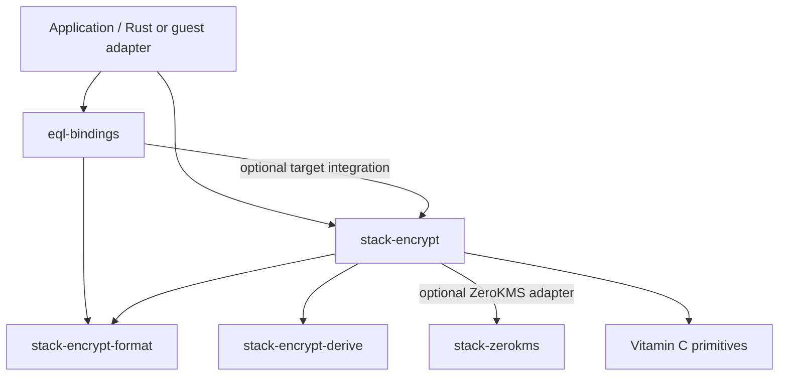

# Stack Encrypt packaging and public names

Dated 25 October 2026, with implementation updates on 27 October 2026 and
7 November 2026. The last check was against `next` at commit `e4990e49b`.
This recommendation for review accompanies the
[implementation plan](2026-10-24-stack-encrypt-api-plan.md).

## Contents

- [Status](#status)
- [Summary of recommendations](#summary-of-recommendations)
- [Terms used in this document](#terms-used-in-this-document)
- [Facts this proposal relies on](#facts-this-proposal-relies-on)
- [Ownership rule](#ownership-rule)
- [Proposed packages](#proposed-packages)
  - [Crates that stay as they are](#crates-that-stay-as-they-are)
  - [Modules, not more crates](#modules-not-more-crates)
  - [Why the format crate is needed](#why-the-format-crate-is-needed)
- [Dependency direction](#dependency-direction)
  - [Providers as optional features](#providers-as-optional-features)
- [What moves out of Vitamin C](#what-moves-out-of-vitamin-c)
  - [Frames and codecs](#frames-and-codecs)
  - [Normalisation and index adapters](#normalisation-and-index-adapters)
  - [Context encoding](#context-encoding)
- [Retire AsyncCipher](#retire-asynccipher)
- [Recommended public glossary](#recommended-public-glossary)
  - [Spellings already agreed](#spellings-already-agreed)
  - [Definition, layout, seal, and open](#definition-layout-seal-and-open)
  - [Ciphertext types in the format crate](#ciphertext-types-in-the-format-crate)
- [JSON names by role](#json-names-by-role)
  - [Notes on the JSON names](#notes-on-the-json-names)
- [Implementation order and acceptance](#implementation-order-and-acceptance)

## Status

This document proposes boundaries and names. The proposals are not
implemented APIs or accepted renames. The naming review of 8 November
2026 judged them. The plan's [Names decided in the naming
review](2026-10-24-stack-encrypt-api-plan.md#names-decided-in-the-naming-review)
records the outcome, and the glossary below matches it. The JSON
operation contract is live, in use as the release candidate Go
`v0.1.0-rc.3`.

## Summary of recommendations

- Stack Encrypt owns the application value model and its execution.
  Vitamin C keeps the reusable cryptographic primitives.
- Add one new crate, `stack-encrypt-format`, and rename `stack-kms` to
  `stack-zerokms`. Use modules, not crates, for the other boundaries.
- Retire Vitamin C's `AsyncCipher` trait.
- Adopt the public glossary for Rust. Keep the merged Go and SQL names for
  JSON.

## Terms used in this document

| Term | Meaning |
| --- | --- |
| Context | Data that a ciphertext is tied to, such as a column name or a row ID. Decryption needs the same context. See [Context and AAD](2026-10-24-stack-encrypt-api-plan.md#context-and-aad) |
| AAD | Additional authenticated data: data that encryption checks for one ciphertext, but does not encrypt. Stack Encrypt builds it from the context. See [Context and AAD](2026-10-24-stack-encrypt-api-plan.md#context-and-aad) |
| Stored format | What is written to the database, as Go `v0.1.0-rc.3` writes it. See [the stored-format decision](2026-10-24-stack-encrypt-api-plan.md#the-stored-format-stays-compatible-with-go-rc3) |

## Facts this proposal relies on

- `encrypt_as` is public on `next`. The structural `decrypt_into` is
  public in `target::legacy`. `StackCipherText` remains for the tree API,
  whose methods are `encrypt_tree` and `decrypt_tree`.
- #1404 implements `Ciphertext`, `EncryptInto`, `DecryptFrom`,
  `OpaqueEncode`, `OpaqueDecode`, `target::EncryptTarget`, and
  `target::DecryptSource`. #1504 adds the derives with those names. #1503 adds `OpaqueBlob`. Both
are open for review. No crate has moved. No rename below is implemented.
- #1501 moves the Rust crates to Vitamin C 0.9, and re-exports `Buffer`,
  `ProtectedRef`, and `AsProtectedRef` from the crate root.
- #1403 bumps `stack-kms` to 0.2.0 on crates.io. So the proposed rename to
  `stack-zerokms` renames a published crate. The rename also touches the
  crate's release-plz version group (`release-plz.toml`,
  `release-plz.yml`), the Go guest, the EQL encryption test crate, and the
  `stack_encrypt::kms` re-export in `lib.rs`. It waits for the naming
  review.
- From 7 November 2026, the stored format must not break. Moving codecs
  and adapters between crates must keep the bytes that Go rc.3 writes.

## Ownership rule

Stack Encrypt owns the application value model and its execution. That
means turning owned Rust values and dynamic values into ciphertext,
structured targets, and search operands, and reconstructing plaintext.
Vitamin C owns reusable primitives for cryptography and protected memory.
An ordinary Stack Encrypt user should not have to import Vitamin C
encryption traits to implement an application type.

Moving code should remove duplicate abstractions. Moving code should not
keep both public surfaces under new names.

Dan's rule of 7 November 2026 applies. Code and APIs may change in ways
that break callers, because this is a prototype. The stored format may
not. Before deleting
dependencies upstream, review the other consumers of Vitamin C that use
them.

## Proposed packages

| Package | Responsibility |
| --- | --- |
| `stack-encrypt` | The public Rust API; traversing and reconstructing values; target declarations and definitions; context and scope roles; normalisation and adapters for searchable targets; plans; batching; JSON tree execution; and validating and executing dynamic definitions |
| `stack-encrypt-derive` | Derive macros that generate the same declarations and definitions a user can write by hand. `stack-encrypt` re-exports the derives |
| `stack-encrypt-format` (new) | Pure data representations and codecs shared by the engine and the bindings: frame primitives and the required scalar representations, the stable format of stored blobs, parsing and encoding of the ciphertext envelope, and validated Base64 and Base85 text. No key requests and no execution runtime |
| `stack-zerokms` (the current `stack-kms`, renamed) | The ZeroKMS protocol client, authentication integration, native keysets, request types for the key request items, and responses. Not the neutral abstraction over several providers |
| `eql-bindings` | EQL storage and query types by version, JSON serialisation compatible with SQL, the catalog, and Stack target adapters. Stays downstream of the engine |
| Vitamin C crates | Protected memory; randomness; AEAD and key operations on bytes; HMAC, PRF, and ORE algorithm primitives; and reusable canonical encoding of context |

The abbreviations in the last row are:

- AEAD: authenticated encryption with associated data;
- HMAC: hash-based message authentication code;
- PRF: pseudorandom function;
- ORE: order-revealing encryption.

### Crates that stay as they are

Keep `stack-auth` and `stack-profile` separate, because they have
consumers outside encryption. Keep `stack-guest-abi` for the calling
convention between the host and the guest. Neither the application binary
interface (ABI) nor the Go host should own a second model of target
policy.

Put the formal dynamic contract, its schemas, and its conformance fixtures
beside Stack Encrypt. The implementation of the dynamic contract uses the
same definition types and validation as static Rust.

### Modules, not more crates

At first, use modules for the remaining boundaries. In particular, do not
create separate crates for execution, JSON policy, queries, context, or
provider traits only so that each concept has its own crate.

### Why the format crate is needed

The format crate has a concrete consumer. EQL's wire types now work
without EQL's optional `stack-encrypt` integration. Those wire types need
shared encoding types without depending on an encryption client or
runtime.

- Put Serde, schema, and TypeScript support behind features, where
  practical.
- Define the trait implementations beside the types the crate owns.
  Otherwise Rust's orphan rule forces downstream crates to duplicate
  wrappers. The orphan rule says an implementation must be in the crate
  of the trait or of the type.
- Re-export the ordinary format types through Stack Encrypt, so users
  normally need only that one dependency.

The format crate is one implementation with separate formats. Each of
these has its own contract and versioning requirements: blob storage, the
transport to and from the guest, and ciphertext envelopes. Sharing code must not
silently turn the Serde mapping for short-lived transport into the stored
blob format.

The format crate does not add a way to store arbitrary internal `Node`
trees. Structured outputs still use their explicit target layout and
ordinary Serde composition.

## Dependency direction

In the diagram, an arrow points from a crate to a crate it depends on.

- The derive crate emits Stack paths. The derive crate does not depend on
  the engine as a normal runtime dependency.
- No Vitamin C primitive depends back on Stack Encrypt.
- `stack-zerokms` does not depend on the engine.
- The provider traits belong in `stack_encrypt::provider`. An adapter
  that Stack owns implements them with the ZeroKMS client. This avoids a
  dependency cycle between the engine and the client.

### Providers as optional features

Make ZeroKMS an optional provider feature, separate from the HTTP feature.
Then a different provider does not bring its protocol into the core
contract. Keep support for injected providers, and for guest and native
builds.

Data key support is the base capability. Index key support, resolving
named keysets, and claims stay explicit optional capabilities. A
required capability that is not supported fails before key I/O, that is,
before any request to the key provider. Future provider adapters can
become separate downstream crates when needed. Do not design invented AWS
or Vault keysets now.

Do not re-export EQL from Stack Encrypt, because EQL's target integration
already depends on Stack Encrypt. Applications import their EQL types
explicitly.

## What moves out of Vitamin C

Move these parts into Stack's value, target, and plan layers:

- the visitors for plaintext and ciphertext that applications use;
- structural nodes;
- the value conversion traits and their derives;
- tree walking;
- collection composition;
- the application encryption helpers.

Keep advanced extension points public only where people who implement
targets need them. These extension points are not part of the normal API
at the crate root. Internal nodes do not become a second public type for
opaque ciphertext.

### Frames and codecs

Move the generic frame code and the codecs that Stack needs into the
format crate. Stack owns the stored blob format and its compatibility
promise.

This refines the earlier recommendation to reuse Vitamin C's frame codec.
Reuse its implementation, with a lossless mapping to storage, but change
who owns it in the long term. Coordinate this handover under
[Vitamin C #519](https://github.com/cipherstash/vitaminc/issues/519). Keep
that issue's work on the format specification and the fixtures. This
proposal has not changed any upstream issue or repository.

### Normalisation and index adapters

Also move the normalisation, PRF, and ORE adapters that understand Stack's
logical values, traversal, targets, or query semantics. Keep the
independent cryptographic algorithms below them in the dependency graph.

The current manifests of `vitaminc-normalize`, `vitaminc-prf`, and
`vitaminc-ore` depend on `vitaminc-aead`. Normalisation even uses the
physical scalar types of `vitaminc-aead`. So moving only the encryption
traits would leave a dependency back to the old value model.

As part of the move, separate primitive inputs from application adapters.
Do not make Vitamin C depend on Stack to get the code to compile.

### Context encoding

Keep the construction of canonical context bytes in `vitaminc-context`,
where independent algorithms use it. Stack owns the semantic roles and the selection rules: scopes, bindings,
the query context, the stored context, and the required parts. Stack reuses that canonical encoding
instead of inventing a second encoding that is not compatible. Provider
policy stays a separate role.

## Retire AsyncCipher

Recommendation: remove Vitamin C's `AsyncCipher` trait and its helpers for
executing application encryption, as the Stack executor takes over that
work. `AsyncCipher` is the Vitamin C trait that seals and opens leaves
asynchronously. Do not add a replacement public async cipher trait in
Stack that covers every case.

Stack already plans and groups the remote key operations, and then runs
the cryptography locally and synchronously. Stack's current `MintedKeys`
and `BoundKeys` implementations use synchronous operations of the leaf
cipher. `AsyncCipher` models a different place to put the asynchronous
work. The asynchronous boundary that matters is the provider and the
public pending operation, with Stack controlling the batching.

Stack does not use `AsyncCipher`. Vitamin C does use it, in these places
in Vitamin C 0.8.0:

- `aead/src/seal.rs`, `context.rs`, `typed.rs`, `walk.rs`, and
  `normalize/src/terms.rs` expose or use async helpers;
- `aead/src/lib.rs` re-exports the trait publicly;
- `aead/src/encrypt_sink.rs` has an `AsyncCipher` bound and imports
  `seal_all_async`;
- the tests in `normalize/tests/known_answers.rs`, and the tests of the
  modules above, implement the trait.

This inventory was taken against 0.8.0. `next` has used 0.9 since #1501,
so the inventory must be checked again before the work starts. To retire
the trait:

1. Move the tests that cover batching, ordering, failures, and
   reconstruction with the code they test.
2. Delete the retired trait and its helpers.
3. Audit external consumers before the upstream release.

Where useful, separate the internal capabilities for sealing leaves and
opening leaves. Do not keep implementations that reject half of a
combined trait.

## Recommended public glossary

| Name or path | Meaning |
| --- | --- |
| `Cipher` | The connection, with credentials and the key provider. Replaces `StackCipher`. Decided on 8 November 2026; the clash with Vitamin C's `Cipher` trait is accepted |
| `Keyset` | The connection bound to one resolved keyset, which encrypt and query calls take. Replaces `KeysetCipher` |
| `CipherRef<'c, K>` | One borrowed value for both paths: a connection and an optional keyset ID. Replaces the `CipherScope` trait and the `dynamic::Scope` enum |
| `Ciphertext` | One opaque encrypted value with a specified storage envelope. Replaces the public use of `StackCipherText = Node<SealedValue>` |
| `OpaqueBlob<T>` | Explicit adapter that serialises a whole owned value |
| `EncryptInto`, `DecryptFrom` | Convenience traits for encryption directed by the target and decryption directed by the destination, with variants that take context |
| `OpaqueEncode`, `OpaqueDecode` | Traits that represent a value as a single ciphertext |
| `target::{EncryptTarget, DecryptSource}` | Declaration traits. The matching derives are re-exported at the crate root |
| `Plan` | A record's declaration as data, built once, shared by the static and dynamic paths. Built by `Plan::scope(..).fields(..)`. Decided on 8 November 2026; `TargetDefinition` is dropped |
| `Scope`, `Bind` | The context argument's two kinds of part, as the plan has them. Neither selects a keyset. The chain they build is the context input; there is no separate type |
| `Query`, `Stored` | The two marker traits on term types: a value a query sends, and a stored index term. Today `op::QueryTerm` and `LabelledTarget` |
| `Op` | The public dynamic operator enum, today `OpSpec` |
| `Plan`, `Planned` on the wire | The two shapes a binding sends: a serialised `Plan` alone for checks, operator lists, and query plans, and a serialised `Planned` for encrypt, query, and decrypt. There is no `Request` type |
| `encoding::{Base64Text, Base85Text}` | Validated encoding of arbitrary bytes. The plan recommends a small Vitamin C encoding crate that Stack Encrypt and EQL re-export; the owner is an open question in the plan |
| `encoding::{Base64Ciphertext, Base85Ciphertext}` | Validated, encoded representations of opaque ciphertext, and supported field targets. Valid encoding alone is not enough |
| `provider` | Neutral provider contracts and capability bounds |
| `provider::zerokms` | The ZeroKMS adapter and the surface for its claims, including `Claim` and `ResolvesClaims` |
| `dynamic` | Loading versioned definitions, discovering capabilities, and executing through the common engine |

### Spellings already agreed

Keep these agreed spellings:

- `encryption_plan()`
- `Planned::new(&plan, value)`, for a value under a plan that is data
- `encrypt` and `encrypt_with_context`, where the marker or the plan fixes
  the output type
- `encrypt_into` and `encrypt_into_with_context`, where the caller names
  the output type
- `decrypt_from` and `decrypt_from_with_context`

There is no `using` method. A typed query starts from the field marker.

Keep the direct `cipher.decrypt` and `decrypt_with_context`. As already
agreed, remove `.encrypt` on plaintext, the redundant `encrypt_as`, and
the public `decrypt_into`.

### Definition, layout, seal, and open

The naming review chose `Plan` for the configured public contract. Use
`Layout`
only for the advanced internal concept of composition, where that
distinction is needed. A layout does not name a plaintext document or a
stored ciphertext.

Name low-level operations on bytes `seal` and `open`. Keep the words
"encrypt" and "decrypt" for the public operations on application values.

### Ciphertext types in the format crate

Keep the ciphertext representations in the format crate independent of
traits. Stack implements its own target traits for those types. Plain
encoded text is not itself an encryption target. Constructing a
ciphertext wrapper must validate both layers: the encoding and the
ciphertext. Avoid a public string constructor without checks.

## JSON names by role

Keep the existing EQL package and its version modules. The merged public
Go surface is `eql.JSONSearch`, `JSONSearchQuery`, `JSONSearchLeafQuery`,
and `JSONEntry`, configured through `JsonSearch`. In SQL, the names are
`eql_v4_json_search`, `query_json`, `query_json_leaf`, and
`eql_v4_json_entry`. The prepared Go objects are `encrypt.JSONSelection`
and `JSONRead`.

The table below is still a proposed glossary for the Rust facade. Its
`JsonTree*` names describe the handwritten Rust adapters, not the
registered Go target. The working Go and SQL surface does not need
renaming to match this glossary. Do not rename it for that reason. Later
Rust renames must keep the frozen dynamic IDs.

| Working or current name | Recommended name | Role | Home |
| --- | --- | --- | --- |
| `JsonPlaintext` | `JsonPlaintext` | Adapter for owned plaintext | `stack_encrypt::json` |
| `JsonOptions` | `JsonTreeOptions` | Validated policy for the tree target | `stack_encrypt::json` |
| `JsonSelection` | `JsonSelection` | Proposed result of a plaintext selection | `stack_encrypt::json` |
| `JsonTreeDocument` | `EncryptedJson` | Stored EQL encrypted document | `eql_bindings::v4` |
| `JsonTreeEntry` | `EncryptedJsonEntry` | Extracted encrypted entry | `eql_bindings::v4` |
| `JsonTreeSubtree` | `EncryptedJsonSubtree` | Encrypted subtree result | `eql_bindings::v4` |
| `JsonTreeQuery` | `JsonContainmentQuery` | Query operand for containment and for a value at a path | `eql_bindings::v4` |
| `JsonTreeLeafQuery` | `JsonOrderingQuery` | Query operand for ordering | `eql_bindings::v4` |
| `JsonTreeSelector` | `JsonSelector` | Encoded path selector | `eql_bindings::v4` |
| `JsonSubtreeKey` | `JsonWalkRequest` | Walk token held by the client, and its binding to the request | Engine type, with a typed EQL adapter |

### Notes on the JSON names

`JsonContainmentQuery` can still be the physical operand of an equality
at a path, where the agreed SQL recipe uses containment. An operation and
its wire operand do not need the same name.

`JsonWalkRequest` describes the real role better than "key" does. The
type contains sensitive capability and request state, not the data
encryption key. The separate review of the JSON contract decides the
exact behaviour of each operation.

Rename the internal target index `Json` to `JsonTreeIndex`. Keep the
internal engine type `JsonDocument` out of the ordinary facade. If adapter
authors need public access to it, give it a name that states its role,
such as `EncryptedJsonTree`.

`EncryptedJson` always means the stored form
that is compatible with EQL. `EncryptedJson` never means some other JSON
serialisation of encrypted nodes. An application's `EncryptedUser` stays
its own declared record layout.

The dynamic identifiers of targets and operations are explicitly
versioned contract identifiers. They are not Rust type names serialised
into JSON. Choose their exact spellings in the interoperability
specification, and use the same glossary in Go. A Rust rename on its own
must not redefine stored SQL formats or dynamic discriminants by accident.

## Implementation order and acceptance

1. Specify and validate the Go JSON and opaque storage contracts. Both
   are now implemented. Freeze the JSON and search semantics after the cascade
   and the exact fixtures. "Post-cascade" means as they are after #1379.
   That change made each container's tag cover the tags of its children.
   Replace the temporary Go module pins of Vitamin C for the final Go
   v0.1.0 release.
2. Complete the outstanding Go match configuration, and close the gaps in
   JSON reads and conformance. Short whole-word matching is implemented in
   EQL. Its leakage and its compatibility with the stored format still need explicit
   acceptance for that release.
3. Set up the shared format crate. Move the
   value model, traversal, and the normalisation and index adapters that
   depend on it into Stack. Keep the frozen encodings and an acyclic
   graph. Move tests with their code.
4. Complete the neutral provider extraction and the renaming of the
   protocol package. Then retire Vitamin C's surface for asynchronous
   application execution. The policy and routing contracts that Go needs
   must be handled before the final Go v0.1.0 release.
5. Complete the public Rust trait and derive names, imports, and
   executable examples. The Go handle rename from the naming review is the one rename of the
   released Go API in this work. Nothing else here renames it or
   reinterprets stored data. The changes must not require customers to
   re-encrypt or reindex.

Acceptance includes:

- an acyclic Cargo graph;
- an EQL build of the wire types only, without the engine;
- engine builds without ZeroKMS and without HTTP;
- native and guest builds;
- the plan's Rust examples compile;
- the behaviour tests that moved;
- shared fixtures for formats and operations across Rust, Go, and SQL.

Full improvements to timing and memory clean-up remain follow-up work. Dan's priority of 7 November 2026 puts the stored
format first. Record only the
guarantees that are true.

This document does not claim any implementation changes, tests of the
proposed API, code moves, or upstream removals.
