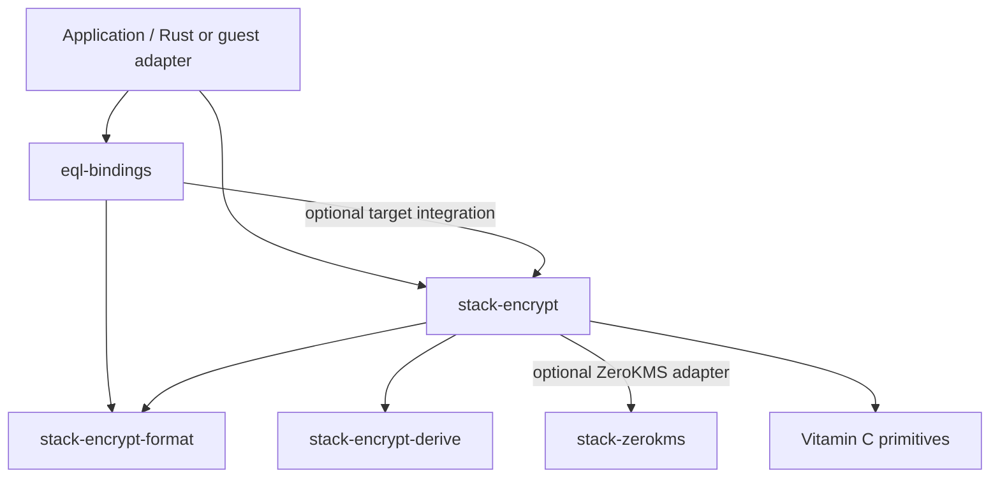

# Stack Encrypt packaging and public names

Date: 2026-10-25. Recommendation for review, accompanying the
[implementation plan](2026-10-24-stack-encrypt-api-plan.md).
These are proposed boundaries and names, not implemented APIs or accepted
renames. Existing companion examples retain their working names until this
proposal is accepted. The detailed JSON operation contract remains under
separate user review.

**Sequencing update:** customer Go delivery supersedes the original
move-first sequence. The JSON stack headed by #1363 has merged. Vitamin C
#520 and #526 address storage and await review/release. Adopt those encodings
and deliver Go JSON/match search first. The package map below is the intended destination; neither a new
format crate nor public Rust facade completion is a customer release gate.

Source baseline: the current documentation branch and inspected local Vitamin
C 0.8.0 sources. Stack's
[cipher implementation notes](../../packages/stack-encrypt/src/cipher.rs)
explain its existing batching boundary. The
[EQL manifest](../../packages/eql/crates/eql-bindings/Cargo.toml) establishes
the optional downstream engine dependency, and
[encoding wrappers](../../packages/eql/crates/eql-bindings/src/encoding.rs)
are the concrete shared-type extraction candidates. This is a source-level
design assessment, not an audit of every external Vitamin C consumer.

## Ownership rule

Stack Encrypt owns the application value model and its execution: turning
owned Rust/dynamic values into ciphertext, structured targets and search
operands, and reconstructing plaintext. Vitamin C owns reusable cryptographic
and protected-memory primitives. A normal Stack Encrypt user should not need
to import Vitamin C encryption traits to implement an application type.

Moving code should remove duplicate abstractions, not preserve both public
surfaces under new names. The user's prototype compatibility exemption
applies to this API; review other Vitamin C consumers before deleting their
dependencies upstream.

## Proposed packages

| Package | Responsibility |
| --- | --- |
| `stack-encrypt` | Public Rust API, value traversal/reconstruction, target declarations and definitions, context/scope roles, normalization and searchable-target adapters, plans, batching, JSON-tree execution, and dynamic definition validation/execution |
| `stack-encrypt-derive` | Derives generating the same declarations and definitions available by hand; re-export derives from `stack-encrypt` |
| `stack-encrypt-format` — new | Pure data representations/codecs shared by the engine and bindings: frame primitives and required scalar representations, stable blob profile, ciphertext envelope parsing/encoding, and validated Base64/Base85 text; no key requests or execution runtime |
| `stack-zerokms` — rename current `stack-kms` | ZeroKMS protocol client, authentication integration, native keysets, lock-context request types, and responses; it is not the neutral multi-provider abstraction |
| `eql-bindings` | EQL versioned storage/query types, SQL-compatible JSON serialization, catalog and Stack target adapters; stays downstream of the engine |
| Vitamin C crates | Protected memory, randomness, byte-level AEAD/key operations, HMAC/PRF and ORE algorithm primitives, and reusable canonical context encoding |

Keep `stack-auth` and `stack-profile` separate: they have consumers outside
encryption. Keep `stack-guest-abi` for the host/guest calling convention.
Neither the ABI nor the Go host should own a second target-policy model.
Put the formal dynamic contract, schemas and conformance fixtures beside
Stack Encrypt; its implementation uses the same definition types and
validation as static Rust.

Use modules for the remaining boundaries initially. In particular, do not
create separate execution, JSON-policy, query, context or provider-traits
crates merely to mirror each concept.

The format crate has a concrete consumer justification: EQL's wire types
currently work without its optional `stack-encrypt` integration. They need
shared encoding types without an encryption client/runtime dependency. Make
Serde, schema and TypeScript support feature-scoped where practical; define
implementations alongside the owned types so downstream orphan rules do not
force duplicate wrappers. Re-export the ordinary format types through Stack
Encrypt, so users normally need only its dependency.

The format crate is a single implementation with distinct profiles. Blob
storage, host/guest transport, and ciphertext envelopes have different
contracts and versioning requirements; sharing code must not silently make
the ephemeral transport Serde mapping the persisted blob format. This does
not introduce persistence for arbitrary internal `Node` trees: structured
outputs still use their explicit target layout and ordinary Serde composition.

## Dependency direction

The derive emits Stack paths but does not depend on the engine as a normal
runtime dependency. No Vitamin C primitive depends back on Stack Encrypt.
`stack-zerokms` does not depend on the engine. Provider traits belong to
`stack_encrypt::provider`; a Stack-owned adapter implements them using the
ZeroKMS client. This avoids an engine/client dependency cycle.

Make ZeroKMS an optional provider feature independently of the HTTP feature,
so a different provider does not pull its protocol into the core contract.
Preserve injected providers and guest/native builds. Data-key support is the
base capability; index-key support, named-keyset resolution and lock context
remain explicit optional capabilities. Unsupported required capabilities
fail before key I/O. Future provider adapters can become separate downstream
crates when needed; do not design fictitious AWS/Vault keysets now.

Do not re-export EQL from Stack Encrypt: EQL's target integration already
depends on Stack Encrypt. Applications explicitly import their EQL types.

## What moves out of Vitamin C

Move application-facing plaintext/ciphertext visitors, structural nodes,
value conversion traits and derives, tree walking, collection composition,
and application encryption helpers into Stack's value/target/plan layers.
Keep advanced extension points public only where target implementers need
them; they are not the normal root API. Internal nodes do not become a
second public opaque ciphertext type.

Move the generic frame machinery and codecs needed by Stack into the format
crate. Stack owns the stored blob profile and its compatibility promise.
This refines the earlier recommendation to reuse Vitamin C's frame codec:
reuse its implementation, with a lossless storage mapping, while changing
its long-term ownership. Coordinate this handoff under
[Vitamin C #519](https://github.com/cipherstash/vitaminc/issues/519); retain
the issue's format specification and fixture work. No upstream issue or
repository has been changed by this proposal.

Also move normalization and PRF/ORE adapters that understand Stack's logical
values, traversal, targets or query semantics. Keep independent cryptographic
algorithms below them. The current `vitaminc-normalize`, `vitaminc-prf` and
`vitaminc-ore` manifests depend on `vitaminc-aead`; normalization even uses
its physical scalar types. Moving only the encryption traits would therefore
leave a dependency back to the old value model. Separate primitive inputs
from application adapters as part of the move; do not add a reverse
Vitamin C dependency on Stack to make it compile.

Retain canonical context byte construction in `vitaminc-context` where it
serves independent algorithms. Stack owns the semantic roles and selection
rules (`PrimaryKey`, `ScopeKey`, ciphertext context, query scope and caller
input capabilities), reusing that canonical encoding instead of inventing
an incompatible second one. Provider policy remains a separate role.

## Retire AsyncCipher

Recommend removing Vitamin C's `AsyncCipher` and its associated application
execution helpers as the Stack executor takes ownership. Do not introduce a
replacement public catch-all async cipher trait in Stack.

Stack already plans and groups remote key operations, then performs local
synchronous cryptography. Its current `MintedKeys`/`BoundKeys` implementations
use synchronous leaf cipher operations; `AsyncCipher` models a different
place to put asynchronous work. The meaningful async boundary is the provider
and the public pending operation, with batching controlled by Stack.

It is unused by Stack, but not unused inside Vitamin C: `aead/src/seal.rs`,
`context.rs`, `typed.rs`, `walk.rs` and `normalize/src/terms.rs` expose or use
async helpers, and their tests implement it. Migrate the relevant batching,
ordering, failure and reconstruction coverage with the code, then delete
the retired trait/helper surface. Audit external consumers before the
upstream release. Separate internal leaf seal/open capabilities where useful
instead of retaining implementations that reject half of a combined trait.

## Recommended public glossary

| Name/path | Meaning |
| --- | --- |
| `stack_encrypt::Cipher` | Provider-backed execution handle; replaces `StackCipher` |
| `KeysetCipher` | Execution handle bound to a resolved keyset, available for providers supporting keysets |
| `Ciphertext` | One opaque encrypted value with a specified storage envelope; replaces the public use of `StackCipherText = Node<SealedValue>` |
| `OpaqueBlob<T>` | Explicit owned whole-value serialization adapter |
| `EncryptInto`, `DecryptFrom` | Target-directed encryption and destination-directed decryption convenience traits, with context variants |
| `OpaqueEncode`, `OpaqueDecode` | Single-ciphertext representation traits |
| `target::{EncryptTarget, DecryptSource}` | Declaration traits; matching derives are re-exported at the crate root |
| `target::TargetDefinition` | Validated immutable definition shared by static and dynamic paths |
| `context::{PrimaryKey, ScopeKey}` | Eligibility wrappers; neither automatically selects a context or keyset |
| `encoding::{Base64Text, Base85Text}` | Validated encoding of arbitrary bytes; owned in the format crate and re-exported here |
| `encoding::{Base64Ciphertext, Base85Ciphertext}` | Validated encoded opaque-ciphertext representations and supported field targets; encoding validity alone is insufficient |
| `plan::Plan` | Explicit low-level composition interface; output selection is `.target::<T>()` |
| `provider` | Neutral provider contracts and capability bounds |
| `provider::zerokms` | ZeroKMS adapter and policy extension surface, including `LockContext` |
| `dynamic` | Versioned definition loading, capability discovery and execution through the common engine |

Keep the already-agreed `.using(...)`, `definition()`, `encrypt`,
`encrypt_with_context`, `encrypt_into`, `encrypt_into_with_context`,
`decrypt_from` and `decrypt_from_with_context` spellings. Keep direct
`cipher.decrypt`/`decrypt_with_context`. Remove plaintext `.encrypt`,
redundant `encrypt_as`, and public `decrypt_into` as already agreed.

Use `TargetDefinition` for the configured public contract and `Layout` only
for the advanced internal composition concept where that distinction is
needed. A layout does not name a plaintext document or a stored ciphertext.
Name low-level operations `seal`/`open` where they act on bytes; reserve the
application encrypt/decrypt vocabulary for the public value operations.

Keep ciphertext representations in the format crate independent of traits;
Stack implements its own target traits for those types. Plain encoded text
is not itself an encryption target. Construction must validate both layers
for the ciphertext wrappers; avoid an unchecked public string constructor.

## JSON names by role

Keep the existing EQL package and version modules. Avoid importing low-level
engine JSON documents into normal application examples alongside EQL output
types. Recommend this glossary for the first-class public surface:

| Working/current name | Recommended name | Role / home |
| --- | --- | --- |
| `JsonPlaintext` | `JsonPlaintext` | Owned plaintext adapter, `stack_encrypt::json` |
| `JsonOptions` | `JsonTreeOptions` | Validated tree-target policy, `stack_encrypt::json` |
| `JsonSelection` | `JsonSelection` | Proposed plaintext selection result, `stack_encrypt::json` |
| `JsonTreeDocument` | `EncryptedJson` | Stored EQL encrypted document, `eql_bindings::v4` |
| `JsonTreeEntry` | `EncryptedJsonEntry` | Extracted encrypted entry, `eql_bindings::v4` |
| `JsonTreeSubtree` | `EncryptedJsonSubtree` | Encrypted subtree result, `eql_bindings::v4` |
| `JsonTreeQuery` | `JsonContainmentQuery` | Containment/path-value query operand, `eql_bindings::v4` |
| `JsonTreeLeafQuery` | `JsonOrderingQuery` | Ordering query operand, `eql_bindings::v4` |
| `JsonTreeSelector` | `JsonSelector` | Encoded path selector, `eql_bindings::v4` |
| `JsonSubtreeKey` | `JsonWalkRequest` | Client-held walk token and request binding; engine type with a typed EQL adapter |

`JsonContainmentQuery` can still be the physical operand for a path equality
operation where the agreed SQL recipe uses containment; operation and wire
operand need not have the same name. `JsonWalkRequest` describes the actual
role better than "key": it carries sensitive capability/request state,
not the data-encryption key. Exact operation behavior remains governed by
the separate JSON contract review.

Rename the internal target index `Json` to `JsonTreeIndex`. Keep the internal
engine `JsonDocument` out of the ordinary facade, with a role-qualified name
such as `EncryptedJsonTree` if adapter authors require public access.
`EncryptedJson` always denotes the EQL-compatible stored form, not any
arbitrary JSON serialization of encrypted nodes. An application's
`EncryptedUser` remains its own declared record layout.

Dynamic target/operation identifiers are explicitly versioned contract
identifiers, not Rust type names serialized into JSON. Select their exact
spellings in the interoperability specification and use the same glossary
in Go. Rust renames alone must not accidentally redefine stored SQL formats
or dynamic discriminants.

## Implementation order and acceptance

1. Use the merged JSON stack and specify Go-visible names/contracts and stable
   profiles needed by the customer. Keep codec work in Vitamin C, coordinating
   #519. Preserve distinct transport/storage semantics and freeze search
   semantics as well as byte layouts.
2. Deliver and validate Go JSON, configurable match search and the selected
   short-input solution under the customer-first sequence. Record frozen Go/data
   fixtures; leave internal Rust plan ergonomics free to change.
3. After delivery, establish the shared format crate and move the value model,
   traversal and dependent normalization/index adapters into Stack. Preserve
   frozen encodings and an acyclic graph; move tests with their code.
4. Complete neutral provider extraction and protocol-package renaming, then
   retire Vitamin C's async application execution surface. Required Go-facing
   policy and routing contracts must already have been handled before release.
5. Complete public Rust trait/derive names, imports and executable examples.
   These changes must not rename the shipped Go API, reinterpret stored
   profiles or require customer re-encryption/reindexing.

Acceptance includes an acyclic Cargo graph; an EQL wire-only build without
the engine; engine builds without ZeroKMS and without HTTP; native/guest
builds; compiled public examples; the moved behavior tests; and shared
Rust/Go/SQL format/operation fixtures. Full timing and memory-cleanup
improvements remain follow-up work under the accepted format-first priority;
record actual guarantees honestly. No implementation changes, tests of the
proposed API, code moves, or upstream removals are claimed by this document.
